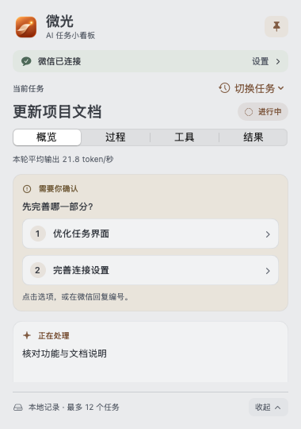
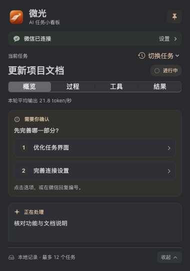
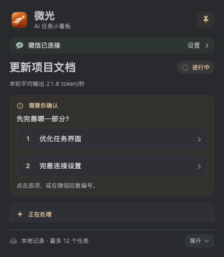
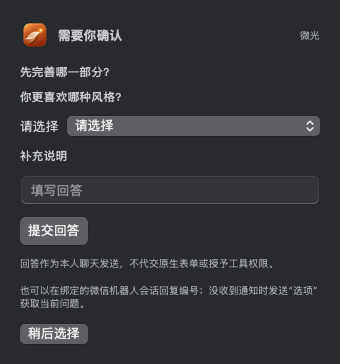

<div align="center">
  
  <h1>微光 · Weiguang</h1>
  <p><strong>See what your Codex task is doing, at a glance.</strong></p>
  <p>A desktop progress card, task and tool history, and optional owner-only WeChat interaction.</p>
  <p>macOS 13+ · SwiftUI / AppKit · Python standard library · MIT</p>
  <p><a href="README.md">中文</a> · <a href="#quick-start">Quick start</a> · <a href="#optional-wechat-interaction">WeChat</a> · <a href="#troubleshooting">Troubleshooting</a></p>
</div>

Weiguang, formerly Agent Progress Card, brings one explicitly bound **Codex conversation** to your desktop:
the current task, public work notes, tool activity and latest reply stay within reach. Optionally connect your
own WeChat account to check progress, send tasks and answer supported choices or requests away from the desk.

Work still runs in your existing Codex conversation. Displaying records and answering local status queries do not
call another model. Sending tasks and choices incurs that conversation's normal model usage; Weiguang needs no separate model API key.

## What it helps with

| When you want to… | Weiguang provides… |
| --- | --- |
| Follow a long-running task without repeatedly switching back to chat | A pinnable card with the current action, public notes and recent calls |
| Find the assistant's most recent reply | A dedicated latest-reply card and a Results view |
| Answer a question that needs your decision | Clickable numbered choices and text/multiple-question forms; supported phone replies are optional |
| See which tools ran or failed | Tool-type filters, a failures-only view and expandable redacted details |
| Follow up while away from your computer | Owner-only WeChat status queries, text to the same conversation and supported formal requests |

Phone interaction requires an available computer, network and bound conversation. See [WeChat setup](#optional-wechat-interaction).

## A look at the interface

Soft neutral grays and muted copper accents follow the system light/dark appearance.
The native window can be dragged, pinned, expanded or collapsed.

<p align="center">
  
  
</p>

These **content-view previews use synthetic task data** and contain no real account, chat or conversation information.

- **Overview**: current action, public notes, pending choices and recent calls.
- **Process**: recent public work records in time order.
- **Tools**: call types, durations, failures and expandable details.
- **Results**: recorded task status and latest completion reply. A completed status is not human acceptance.

<details>
<summary>See the compact view and a text-answer form</summary>

<p>
  
  
</p>

Short questions fit their contents. Long questions, multiple choices and forms remain scrollable.
Ordinary chat answers and formal tool approvals use different handling.

</details>

## Quick start

Run the following commands from this repository's root. Initial setup uses the terminal and builds locally.

### 1. Prepare and build

You need **macOS 13+, Xcode Command Line Tools, Python 3.10+**, and an installed Codex client.
The command-line packages use the Python standard library. The bundled collector uses CLT's `/usr/bin/python3`;
that subset also supports Python 3.9.

If the build tools are missing, run `xcode-select --install` and complete installation first.

```bash
git clone https://github.com/chengxianhe/agent-progress-card.git
cd agent-progress-card
bash desktop/build.sh
```

This builds `build/微光.app` for your machine's architecture. It is ad-hoc signed, not Apple-notarized.

### 2. Select and attach one Codex conversation

Open the intended conversation in Codex and ensure it has started at least one task turn. Identify:

| Parameter | Value |
| --- | --- |
| `--transcript` | The full path to that conversation's `rollout.jsonl` |
| `--thread-id` | The UUID of the same conversation |

If you do not know these values, ask the assistant in that conversation to help verify them; you do not need to
share your whole chat directory. There is currently no graphical conversation-selection wizard.

```bash
# Replace both placeholders with values from the same conversation.
PYTHONPATH=src python3 -m agent_progress_card.attach \
  --transcript /absolute/path/to/rollout.jsonl \
  --thread-id THREAD_UUID
```

Attachment validates the identity and collects public events from the latest task turn onward.
It does not guess or switch to other conversations.

### 3. Publish your first card task, then open the window

**Attachment collects records; a user, assistant or script explicitly publishes the task title and status.**
For your first task:

```bash
PYTHONPATH=src python3 -m agent_progress_card begin \
  --title 'My first task' --action 'Waiting for a work update'
open "build/微光.app"
```

Keep the returned `task_id`. This creates a display record; start the actual work in the bound Codex conversation.
Continue a task there: the card should show your title, then refresh public notes, tool records and replies.
Use `update` for stages and status changes; see [publishing progress](#publish-progress-from-an-assistant-or-script).

### 4. Install the app and keep it in the Dock

After checking the local build, optionally install it:

```bash
python3 desktop/install.py
open "$HOME/Applications/微光.app"
```

The installer refuses to overwrite an existing new-name or old-name app. Read [migration instructions](docs/migration.md) before upgrading.
Existing history, bindings and credentials retain their data locations. The application file and its Dock name are **微光**.

To keep it in the bottom Dock, open the app, Control-click its icon and choose **Options → Keep in Dock**.
See [Apple's Dock guide](https://support.apple.com/guide/mac-help/mh35859/mac).
For a double-clickable desktop entry, create a Finder alias of 微光.app and put the alias on the desktop; keep the actual app installed.

Closing the window hides the card. `Cmd+Q` exits the app and its collector follows its parent process out.
WeChat background services are managed separately.

## Optional WeChat interaction

**Skip this section if you only want the desktop card.** The relay uses the same already-open Codex conversation.
Your account must support iLink/ClawBot, and the local Codex control socket must be available. Pairing availability depends on the service.

After attaching the desktop card, keep that conversation open in Codex and run:

```bash
PYTHONPATH=src python3 -m agent_progress_wechat.relay \
  --state-dir "$PWD/runs/wechat" --thread-id THREAD_UUID
```

Scan the QR code in the card's connection settings and enter a pairing code if prompted.
Initially this can run in the foreground; `Ctrl+C` stops that process. Install the optional
[per-user supervisor](docs/wechat-resident.md) explicitly if you want background operation.

| Send to your paired bot | What happens |
| --- | --- |
| Ordinary text | Sends a task or follow-up to the bound Codex conversation, with normal model usage |
| `进度` / `结果` / `帮助` | Reads local progress, results or help without starting another model task |
| `选项` | Retrieves the current ordinary question; use the complete reply code shown in the notice |
| `审批` | Lists active requests; `审批 2` requests page 2 and `审批 A_CODE` retrieves one full request |
| `诊断` / `出门检查` | Reports current transport, task, approval, collector and supervision evidence |

**C codes are ordinary chat choices; A codes are formal requests.** Follow each notice's actual order instead of
assuming that a fixed number means Allow. Read all detail parts before deciding.
Multiple-question and text replies use the displayed `填写 C_CODE JSON` or `填写 A_CODE JSON` format.

Phone adapters for commands, MCP approvals and supported formal forms are opt-in: stop the existing relay normally,
then add `--remote-approvals` to its command. Restart with `--no-remote-approvals` to disable them.
The preference is retained for that paired account and conversation; Codex model and permission policies remain unchanged.
Persistent grants, identity checks, secret inputs and unsupported structures need their native client.
See [request coverage](docs/remote-approvals.md).

Disconnection or restart drops historical pending notifications. Fresh owner input resumes delivery with one current
summary; active questions and requests can be queried on demand. Login expiry, sleep and upstream rejection still affect
availability. Background supervision cannot guarantee continuous phone delivery.
See [WeChat details](docs/wechat.md) and [recovery behavior](docs/wechat-queue-policy.md).

## Publish progress from an assistant or script

Give the assistant this command convention. Run from the Weiguang repository root and replace `TASK_ID` with the actual ID.

```bash
# Start a card task and retain its task_id.
PYTHONPATH=src python3 -m agent_progress_card begin \
  --title 'Update project docs' --action 'Check existing features'

# Publish a stage.
PYTHONPATH=src python3 -m agent_progress_card update \
  --task-id TASK_ID --status running --action 'Checking setup instructions'

# Leave the result for human review.
PYTHONPATH=src python3 -m agent_progress_card update \
  --task-id TASK_ID --status waiting --action 'Checks passed; ready for review'
```

States are `running`, `waiting`, `succeeded` and `failed`. Human acceptance remains a separate decision.
Update the existing ID when a task is active. `begin --replace` explicitly switches the display; it does not cancel Codex work.

Publish an ordinary choice:

```bash
PYTHONPATH=src python3 -m agent_progress_card choice \
  --question 'Which part first?' --option 'Improve the UI' --option 'Document setup'
```

Acknowledged card/WeChat delivery clears the choice. If the user answers directly in chat, the assistant calls `clear-choice`.
Ambiguous delivery is not automatically repeated.

## Troubleshooting

| Symptom | Start here |
| --- | --- |
| The card keeps waiting for a task | Attaching is separate from creating a task; run `begin` and confirm the bound conversation is open |
| No task turn was found | Start at least one task turn in that Codex conversation; verify the path/UUID pair |
| The title remains but records stop changing | It may be the last known state; check Codex, collector and binding, or send `诊断` in WeChat |
| Phone notifications stop arriving | Send `进度` in your paired bot chat; an expired reply context is different from expired login |
| WeChat continues after the window closes | The services are independent; use Stop WeChat Sync to pause the relay |
| Will it work while my computer is off or asleep? | Availability is not guaranteed; the computer, network and conversation must remain available |

Weiguang reads public events from the specified conversation. It does not expose internal reasoning or read
personal WeChat contacts, chat lists or groups. Tool details are redacted and bounded. History retains up to
12 tasks, 20 calls and 30 work notes per task; it is not a complete audit archive.

State lives under `~/Library/Application Support/AgentProgressCard/`; WeChat credentials live in the selected state directory.
Do not share credentials, QR codes, databases, raw chats or real conversation identifiers. Redaction is best effort; review before sharing records.

## Documentation and development

- [WeChat setup and troubleshooting](docs/wechat.md) · [Phone approvals and forms](docs/remote-approvals.md)
- [A/C reply routing](docs/mobile-approval-routing.md) · [Request coverage and recovery](docs/recovery-and-mobile-requests.md)
- [Background supervision](docs/wechat-resident.md) · [Migration](docs/migration.md)
- [Verification](docs/verification.md) · [UI and naming decisions](docs/design-weiguang.md)

```bash
bash scripts/verify.sh
```

This macOS revision runs **212 Python tests, two native builds and eight model suites**.
Tests use synthetic data and do not send live WeChat messages. The user confirmed this local Dock icon and name;
that does not establish live acceptance for every phone request. Formal forms, file changes and turn-scoped permissions
retain their individual [verification limits](docs/verification.md). The local Codex interface is experimental; revalidate after client upgrades.

Sources: `desktop/` for native UI/build tools, `src/agent_progress_card/` for collection and records,
`src/agent_progress_wechat/` for the relay, and `tests/` for regression coverage.

[MIT License](LICENSE) · Attribution and origins: [NOTICE](NOTICE).
