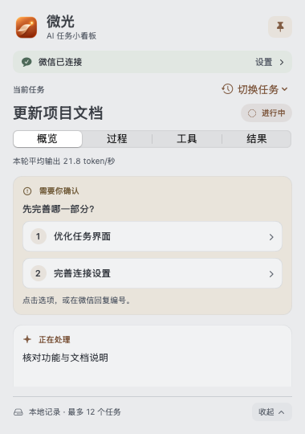
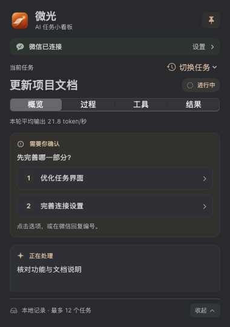
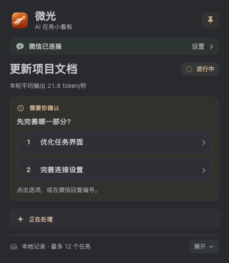
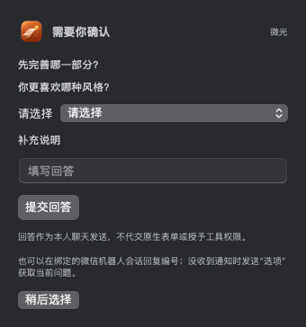

<div align="center">
  
  <h1>微光</h1>
  <p><strong>让 Codex 在忙什么，一眼就能看见。</strong></p>
  <p>桌面进度卡片 · 任务与工具记录 · 可选本人微信交互</p>
  <p>macOS 13+ · SwiftUI / AppKit · Python 标准库 · MIT</p>
  <p><a href="README.en.md">English</a> · <a href="#快速开始">快速开始</a> · <a href="#通过本人微信交互">微信使用</a> · <a href="#常见问题">常见问题</a></p>
</div>

微光（原名 Agent Progress Card）把一个明确绑定的 **Codex 会话**放到桌面上：当前任务、公开工作说明、工具调用和最近回复随时可见。
需要离开电脑时，还可以连接本人微信，查进度、发任务，并回复已支持的选择与请求。

**0.2.0 预览版**已加入内置运行环境、首次连接引导和首个任务自动创建；可选微信扫码也有图形入口。

任务仍由原有 Codex 会话执行。桌面记录和本地查询不额外调用模型；发任务与回复选择使用该会话的正常模型用量，无需为微光另配模型 API Key。

## 它可以帮你做什么

| 你遇到的情况 | 微光提供的帮助 |
| --- | --- |
| 助手跑了很久，不知道做到哪一步 | 置顶小卡片展示当前动作、公开说明与最近工具记录，减少反复切回聊天 |
| 已经结束一轮，想找它刚才的回复 | 单独显示最近回复，并在「结果」中回看当前任务记录 |
| 助手需要你作出选择 | 普通选项可直接在卡片点选，也可在微信按通知回复编号；多题和文字回答有表单 |
| 想看看刚才调用了什么、哪里失败了 | 「工具」可按类型筛选、仅看失败项，并展开脱敏后的参数与返回内容 |
| 暂时离开电脑，仍想跟进 | 可选本人微信通道支持本地进度查询、向原会话发文字，以及已适配的正式请求 |

微信使用需要电脑保持运行、网络与绑定会话可用。支持范围见下方[微信说明](#通过本人微信交互)。

## 界面是什么样的

柔和中性灰、低饱和铜色点缀，跟随系统深浅色模式。原生小窗支持拖动、置顶、展开与收起。

<p align="center">
  
  
</p>

以上是**使用合成任务数据渲染的正文界面示例**，没有真实账号、聊天或会话信息。

- **概览**：当前动作、公开说明、待选问题和最近调用。
- **过程**：按时间回看最近的公开工作记录。
- **工具**：查看调用类型、耗时、失败项与可展开详情。
- **结果**：查看任务状态与最近完成回复；状态完成不等于已经人工验收。

<details>
<summary>看看收起状态和文字回答表单</summary>

<p>
  
  
</p>

短问题按内容高度显示；长问题、多个选项和表单可滚动查看。普通聊天回答与正式工具授权使用不同的处理方式。

</details>

## 快速开始

### 安装包使用（普通用户）

选择与你的 Mac 对应的 DMG：**Apple 芯片用 arm64，Intel 用 x86_64**。需要 macOS 13+ 和已安装的 Codex 客户端。
App 已内置 Python 3.12，使用安装包**不需要安装 Python、Xcode 或克隆源码**。

> 当前产物是 **0.2.0 预览版**，仅 ad-hoc 签名，尚未经过 Apple Developer ID 签名和公证，macOS 可能拦截打开。
> 预览包还未发布到 GitHub Releases；面向普通用户的正式下载须等签名、公证完成后提供。

本地构建会生成以下安装包；**推送源码不会同时上传这些 DMG**：

| 你的 Mac | 对应安装包 |
| --- | --- |
| Apple 芯片（M 系列） | `Weiguang-0.2.0-macos-arm64-preview.dmg` |
| Intel 处理器 | `Weiguang-0.2.0-macos-x86_64-preview.dmg` |

两个包都已做挂载与内置运行环境测试；Intel 包是在 Apple 芯片 Mac 的 Rosetta 下验证，尚未做真实 Intel 硬件验收。

1. 打开 DMG，把「微光.app」拖到 `Applications`，再从应用目录打开。
2. 首次引导中，在 Codex 的目标对话先发一条消息，再点击「选择会话记录」。
   文件选择器默认打开 `~/.codex/sessions`，按日期选择该对话的一份 `rollout-….jsonl`。
   不知道对应文件时，请该对话的助手提供路径；微光只读取你选中的文件。
3. 会话编号自动识别，给任务取名后点击「连接并开始记录」，首个任务会自动创建。
4. 点击「复制给助手的进度接入说明」，粘贴到同一个 Codex 对话，助手即可用内置 CLI 更新任务阶段。

公开说明、工具和回复会自动采集；任务阶段与完成状态仍由助手显式发布。
重新选择会话可点窗口顶部的连接按钮，已有数据时需确认切换，旧任务记录会保留。
切换不会取消 Codex 的工作；原微信绑定不会自动跟随另一个会话。

### 从源码构建（开发者）

构建需要 Xcode Command Line Tools、Python 3.10+ 和网络。首次构建会下载校验过的固定版本 Python 运行环境。

```bash
git clone https://github.com/chengxianhe/agent-progress-card.git
cd agent-progress-card
bash desktop/build.sh
open "build/微光.app"
```

构建结果与安装包使用同一套首次引导。生成两种架构的预览 DMG：

```bash
python3 desktop/package.py --arch both --preview
```

输出到 `dist/`，包含 `SHA256SUMS`；不会安装 App、覆盖现有版本或发布到 GitHub。
正式签名、公证及验收范围见[发行说明](docs/distribution.md)。

要固定到底部 Dock，打开 App 后右键点按其图标，选择「选项 → 在程序坞中保留」。
这是 macOS 的常规操作，见 [Apple 程序坞说明](https://support.apple.com/zh-cn/guide/mac-help/mh35859/mac)。
桌面需要可双击的入口时，可在访达中为「微光.app」创建替身并放到桌面；保留实际 App 在应用目录。

关闭窗口会隐藏卡片；`Cmd+Q` 退出 App，并让它启动的采集器随父进程退出。微信后台单独管理。

## 通过本人微信交互

**只想用桌面看板，可以跳过这一节。** 微信通道连接同一个已打开的 Codex 对话，不另开聊天上下文。
账号需要支持 iLink/ClawBot，且本机 Codex 控制 socket 可用；是否可配对以实际服务返回为准。

完成首次引导后，保持目标会话打开，点卡片上的「连接本人微信（可选）」，再点「开始扫码连接」。
二维码和配对码会显示在连接页。首次默认关闭手机正式请求适配，可在扫码前显式勾选。
不会自动安装登录自启动项；需要后台监督时，再按[常驻说明](docs/wechat-resident.md)显式安装。
已有连接继续使用原凭据和设置，图形引导不会自动迁移或覆盖它们。

高级用户也可通过 App 自带 CLI 启动，`THREAD_UUID` 替换为已绑定会话编号：

```bash
"/Applications/微光.app/Contents/MacOS/weiguang-cli" --wechat \
  --state-dir "$HOME/Library/Application Support/AgentProgressCard/wechat" --thread-id THREAD_UUID
```

| 在本人机器人会话发送 | 你能做什么 |
| --- | --- |
| 普通文字 | 向已绑定的 Codex 会话发任务或补充要求，产生正常模型用量 |
| `进度` / `结果` / `帮助` | 从本地状态获取信息，不开启新的模型任务 |
| `选项` | 获取当前普通问题，按通知里的完整编号回复 |
| `审批` | 查询有效请求列表；`审批 2` 翻页，`审批 A编号` 获取一项完整详情 |
| `诊断` / `出门检查` | 查看微信、任务会话、审批、采集和监督的当前证据 |

**C 编号是普通聊天选择，A 编号是正式请求。** 按每次通知原文回复，不凭固定数字猜“允许”。
收到通知里的完整详情后，再作出明确选择。多题或文字输入按通知使用 `填写 C编号 JSON` 或 `填写 A编号 JSON`。

命令、MCP 授权及受支持的正式表单需要显式启用手机请求适配：先正常停止已有 relay，再在原命令中增加
`--remote-approvals`；以 `--no-remote-approvals` 重启可关闭。设置按绑定账号和会话保存，不修改 Codex 的模型或权限策略。
长期放行、身份验证、秘密输入和未支持结构仍需原客户端；完整范围见[手机请求说明](docs/remote-approvals.md)。

断开或重启后不补发历史通知；本人发送新消息后恢复，只自动发一条当前摘要。有效问题和请求按需查询。
登录失效、电脑休眠或上游拒收仍会影响送达，后台常驻不能保证手机永远在线。详见[微信连接](docs/wechat.md)与[恢复策略](docs/wechat-queue-policy.md)。

## 让助手或脚本更新进度

首次引导的复制按钮会包含当前任务 ID 和实际 App 路径；窗口顶部连接按钮的右键菜单也可再次复制。
下面示例假设安装在 `/Applications`，用实际 `task_id` 替换 `TASK_ID`。

```bash
# 开始任务，返回 task_id。
"/Applications/微光.app/Contents/MacOS/weiguang-cli" begin \
  --title '更新项目文档' --action '核对现有功能'

# 发布一个阶段。
"/Applications/微光.app/Contents/MacOS/weiguang-cli" update \
  --task-id TASK_ID --status running --action '正在核对使用步骤'

# 留给人确认。
"/Applications/微光.app/Contents/MacOS/weiguang-cli" update \
  --task-id TASK_ID --status waiting --action '检查完成，等待你审阅'
```

支持 `running / waiting / succeeded / failed`。自动检查通过可记录为完成相应工作，人工验收仍由人确认。
已有任务时优先更新原 ID；`begin --replace` 仅明确切换显示，不会取消 Codex 正在执行的工作。

发布一个普通选择：

```bash
"/Applications/微光.app/Contents/MacOS/weiguang-cli" choice \
  --question '先做哪项？' --option '优化界面' --option '补充文档'
```

卡片或微信投递收到回执后自动关闭选择；聊天里直接回答后，由助手调用 `clear-choice`。
回执不确定时不自动重发，避免重复执行。

## 常见问题

| 问题 | 先检查什么 |
| --- | --- |
| 别人需要安装开发环境吗 | 使用完整安装包无需 Python、Xcode 或源码；仍需 macOS 13+、Codex 和目标会话记录 |
| 打开后一直等待任务 | 完成首次引导并确认是目标会话；引导会自动创建首个任务 |
| 提示「未找到会话轮次」 | 该 Codex 会话须先开始过一轮任务，路径和 UUID 也必须匹配 |
| 标题还在，记录不刷新 | 卡片可能是最后记录；检查 Codex、采集状态与绑定，微信可发 `诊断` |
| 微信收不到通知 | 先在本人机器人会话发送 `进度`；回信上下文失效与登录失效不同，按连接状态处理 |
| 关闭窗口后微信还在同步 | 窗口与微信后台独立；用「停止微信同步」暂停，而不是只关窗口 |
| 电脑关机或休眠后还能用吗 | 不能保证；现有电脑、网络与会话需要保持可用 |

微光只读指定会话的公开事件，不展示内部推理，也不读取个人微信联系人、聊天列表或群聊。
工具内容会脱敏、限长；历史保留最多 12 个任务，每任务最多 20 条调用和 30 条工作记录，不能当完整审计归档。

状态位于 `~/Library/Application Support/AgentProgressCard/`；微信凭据在你指定的状态目录。
请勿分享凭据、二维码、数据库、原始聊天或真实会话标识。脱敏属于尽力处理，分享记录前仍需检查。

## 更多文档与开发

- [微信连接与故障处理](docs/wechat.md) · [手机授权与表单](docs/remote-approvals.md)
- [手机编号分流](docs/mobile-approval-routing.md) · [请求覆盖与恢复边界](docs/recovery-and-mobile-requests.md)
- [后台常驻](docs/wechat-resident.md) · [旧版本迁移](docs/migration.md)
- [安装包、签名与公证](docs/distribution.md) · [首次使用交付记录](docs/first-run-delivery-20261113.md)
- [验证记录](docs/verification.md) · [界面设计与更名记录](docs/design-weiguang.md)

```bash
bash scripts/verify.sh
```

0.2.0 本轮自动检查通过：**222 项 Python 测试、两个原生入口构建和 8 组模型测试**。
两种预览安装包另通过挂载、运行环境搬迁和合成会话首次连接检查；正式签名、公证及干净机器安装仍待验证。
自动测试使用合成数据，不向真实微信发送消息。本机 Dock 图标与名称已由用户确认；这不等于所有手机请求均已实测。
正式表单、文件修改、本轮权限等仍按各自[验证边界](docs/verification.md)看待。Codex 本地接口属于实验性适配，升级客户端后需复验。

源码：`desktop/` 原生界面与构建，`src/agent_progress_card/` 记录与采集，`src/agent_progress_wechat/` 微信桥接，`tests/` 回归。

[MIT License](LICENSE) · 原始来源见 [NOTICE](NOTICE) · 内置运行环境见 [第三方声明](THIRD_PARTY_NOTICES.md)。
